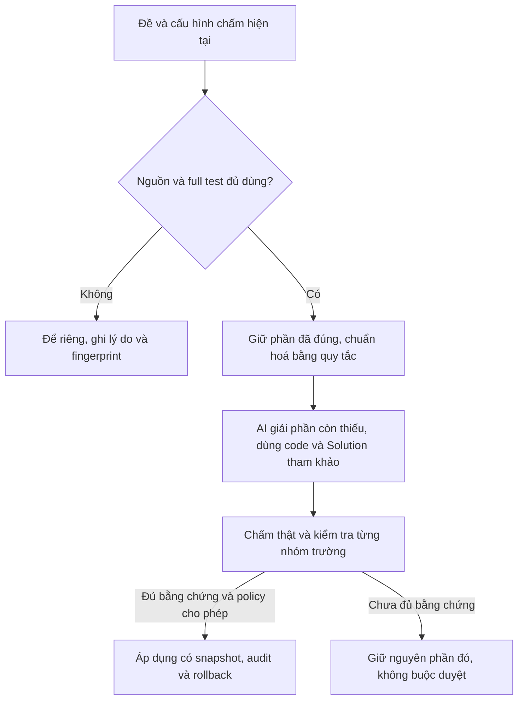

# Chuẩn hoá bài tập: triển khai giảm duyệt và kiểm soát bằng chứng

Ngày: 20/11/2026. Nhánh: `codex/mrtee-hncode-standardization-v3`.

**Cập nhật tiếp theo:** đã bổ sung profile phản biện kết hợp code tác giả, finalizer tự áp dụng, danh sách vấn đề và reservation. Xem [quy trình chạy thật](STANDARDIZATION_PRODUCTION_WORKFLOW.md); các giới hạn tương ứng mô tả bên dưới là trạng thái của bản triển khai đầu.

## 1. Mục tiêu và phạm vi

Triển khai các cửa kiểm tra và phân luồng trong [thiết kế](STANDARDIZATION_LOW_REVIEW_DESIGN.md), ưu tiên không áp dụng sai, không gọi AI cho bài thiếu căn cứ và không biến toàn bộ bản nháp thành yêu cầu duyệt bắt buộc.

Đây là bộ máy tự xử lý **từng phần có bằng chứng**, chưa phải chứng nhận toán học tự động cho mọi lời giải. Những phần chưa đủ kiểm chứng được để riêng và giữ nguyên dữ liệu gốc. Việc tách riêng không xoá hay ẩn bài trên website.

## 2. Quy trình sau thay đổi



### Kiểm tra trước AI và trước mọi auto apply

`source_readiness()` dùng chung cho guided, AI step và policy:

- Thiếu đề, chỉ có tên hoặc chỉ có mẫu: tách riêng.
- Nguồn không đọc được, OCR chưa chắc, nguồn mâu thuẫn hoặc tệp hỏng: tách riêng.
- Đề và DB/init.yml mâu thuẫn về nhập xuất hoặc loại tác vụ: tách riêng.
- Bài hàm, tương tác và output-only: giữ ở luồng riêng; chưa ép qua luồng C++ thông thường.
- Phải có danh sách `test_cases` đầy đủ, điểm dương, cấu trúc batch hợp lệ, tệp vào/ra và checker/generator cần dùng. Chỉ có pretest không đủ.
- Kiểm tra mục lục và CRC của ZIP; kết quả CRC được cache theo fingerprint nội dung. Không giải nén vào filesystem và không gửi test ẩn cho AI.
- Không đặt ngưỡng số test để giả định test tốt. Không có code AC hoặc không có ví dụ cũng không tự động đồng nghĩa thiếu đề.
- Kế thừa cảnh báo ngữ nghĩa từ Solution mới nhất khi còn khớp phiên bản đề, để cấu hình không đi vòng qua bài đang thiếu căn cứ.

Fingerprint gồm đề, PDF, cấu hình chạy và tệp chấm thực tế. Đổi tag, Points, tác giả hoặc Solution không tự mở lại bài thiếu nguồn. Đổi nguồn/test liên quan cho phép xét lại. Kết luận vẫn được kiểm tra lại tại thời điểm apply.

### Chuẩn hoá đề bảo toàn

`preserve_format()` nhận diện các heading Markdown rõ ràng bằng tiếng Việt/Anh và đổi thành `### Input`, `### Output`, `### Example`, `### Scoring` nếu có. Câu chữ, công thức, bảng, ảnh và tên tệp được sao chép.

Vùng ví dụ chỉ gồm các cặp code fence rõ ràng có thể được bọc theo mẫu HNCode bằng quy tắc. Ví dụ trộn bảng, chú thích hoặc cú pháp chưa nhận diện được giữ nguyên; không đoán cách ghép các đoạn.

Parser chỉ bỏ phần thụt dòng thuộc khung Markdown. Khoảng trắng đầu/cuối dữ liệu, tab và dòng trống có ý nghĩa được giữ. CRLF được chuẩn hoá về LF khi biểu diễn Markdown; đây không phải cam kết bảo toàn byte CRLF của tài liệu gốc.

Nếu chỉ sửa được heading (`HEADINGS_OK`) mà chưa chuẩn khung ví dụ (`STRICT_OK`), thao tác bảo toàn vẫn có thể áp dụng nhưng nhóm đề được ghi **hoàn tất một phần**. Không cộng các ca này vào số bài chuẩn hoá hoàn chỉnh.

Kết quả quy tắc được tính lại để chứng minh trước auto apply; không tin một cờ `preservation=true` do AI gửi. Với nguồn không chứng minh được, mặc định không mua một lượt viết lại toàn đề khó tự áp dụng: giữ nguyên phần đề và tiếp tục những nhóm khác. `STANDARDIZATION_GUIDED_AI_REWRITE=True` là lựa chọn có chủ ý để tạo bản nháp AI cho các trường hợp này, vẫn phải qua các gate tương đương.

## 3. Điều kiện theo nhóm trường

| Nhóm | Điều kiện/chính sách |
| --- | --- |
| Cấu hình | Giải được profile MrTee và bốn runtime có judge hỗ trợ; bật partial; bộ nhớ tối thiểu 1024 MB; không giảm giới hạn lớn hơn; Solution riêng tư; giữ nguyên test/checker |
| Đề | Có chứng minh biến đổi bảo toàn hoặc vượt đầy đủ gate viết lại hiện có; heading đúng; không sửa dữ liệu mẫu theo suy đoán |
| Code | Full judge trên đúng mã nguồn, đúng phiên bản đề và cấu hình; không nhận compile-only hoặc pretest là đạt |
| Hướng dẫn | Code AC không chứng nhận phần văn bản. Auto apply của đề xuất AI cần bản xác nhận nội dung gắn đúng code, nội dung và bộ test; chưa có thì để riêng |
| Tag | AI chỉ bổ sung, không xoá tag giáo viên; tag mới cần baseline đã đánh giá theo cùng prompt/step/model; confidence tự báo không đủ |
| Points | Rating chính thức từ nguồn tương đương đã xác nhận hoặc baseline hiệu chuẩn; rating AI vẫn là ước lượng, không phải rating Codeforces chính thức |

Baseline mặc định tối thiểu cho tag mới và Points do AI đề xuất: 100 bài khác nhau được người có quyền đánh giá, tỷ lệ đồng ý ít nhất 98%. Không cho profile hạ hai sàn này. Đây là **điều kiện vận hành**, không có nghĩa hệ thống được chứng minh chính xác 98%; mẫu không đại diện vẫn gây sai lệch. Những quyết định duyệt lặp lại hoặc nhiều phiên bản của cùng một bài không được tính thành nhiều mẫu.

Nút **Xác nhận đã kiểm tra hướng dẫn** là lựa chọn của người có quyền, sau khi code đã qua full judge. Nó ghi chứng cứ riêng, không sửa hoặc xuất bản Solution. Không bắt người dùng bấm nút này cho mọi bài: phần chưa có căn cứ tiếp tục nằm riêng. Chứng cứ mất hiệu lực khi nội dung/code/cấu hình liên quan đổi.

## 4. Sửa các lỗi policy và bằng chứng

1. Chọn bản mới nhất trên **toàn bộ trạng thái, prompt, step và batch**, sau đó mới lọc pending và scope policy. Bản mới bị giữ lại/từ chối không làm bản pending cũ sống lại.
2. Kiểm tra lại điều kiện trong giao dịch khoá problem/policy/proposal, bao gồm đường gọi auto apply trực tiếp.
3. Bỏ kiểm tra ngân sách sinh AI khỏi bước áp dụng. Batch đã dùng hết tiền AI vẫn có thể áp dụng kết quả đủ bằng chứng; batch đang pause/cancel vẫn bị chặn theo trạng thái.
4. Phân biệt `full_judge` với kiểm tra khác. Kết quả thông tin mới không che mất AC; thất bại mới của đúng code/config sẽ chặn thành công cũ.
5. Lỗi hậu kiểm nghiêm trọng dừng policy ngay, không đợi đủ số mẫu. Hàng mẫu hậu kiểm chạm trần mặc định 100 sẽ ngừng nhận thêm apply.
6. Resume policy mở một mốc hậu kiểm mới, giữ nguyên lịch sử cũ. Nút resume trong admin dùng cùng logic.
7. Tái dùng Solution hiện có cần khớp bản đã áp dụng và chứng cứ full judge hiện tại; đủ ba heading không còn là điều kiện đủ.

## 5. Trạng thái và giao diện

`StandardizationDisposition` lưu một dòng toàn bài và các dòng theo nhóm trường, kèm lý do, fingerprint, batch và thời điểm:

| Trạng thái | Ý nghĩa |
| --- | --- |
| `ready` | Đủ nguồn để tiếp tục kiểm tra, chưa phải đã hoàn tất |
| `auto_done` | Nhóm trường đã áp dụng tự động; toàn bài chỉ hoàn tất khi đủ các nhóm |
| `auto_partial` | Đã áp dụng một số nhóm, phần còn lại giữ nguyên |
| `deferred_source` | Thiếu căn cứ/dữ liệu, tách riêng toàn bài |
| `deferred_verification` | Chưa đạt điều kiện kiểm chứng; không bắt buộc duyệt |
| `retry_infra` | Chờ máy chấm/provider; không kết luận bài sai |

Trang internal có các bộ lọc riêng; mặc định tách bài thiếu nguồn khỏi danh sách đang xử lý. Admin có danh sách chỉ đọc để tra lý do, fingerprint và batch. Nhãn AC được đổi thành “Code đạt bộ test”, không gọi là chuẩn hoá xong.

Đây là trạng thái theo lần kiểm tra gần nhất. Sau khi sửa nguồn/test, chạy lại kiểm tra để cập nhật phân luồng. Không dùng số bài AC làm tỷ lệ toàn bộ trường đã đạt chuẩn.

## 6. Vận hành

```sh
python manage.py migrate
# Chỉ kiểm tra, không gọi AI và không thay đổi bài:
python manage.py standardize_readiness --codes aplusb,threepoint
# Ghi kết quả phân luồng; vẫn không sửa các trường của bài:
python manage.py standardize_readiness --codes aplusb,threepoint --save
# Lập kế hoạch một lô hữu hạn, chưa gọi AI:
python manage.py standardize_guided --actor MrTee --from-id 1 --through-id 100 --limit 100
```

Để enqueue AI dùng lệnh guided hiện có với `--enqueue` và ngân sách phù hợp. Nên xử lý theo lô hữu hạn, kiểm tra mẫu, rồi tăng dần. Không bật tự áp dụng toàn bộ production chỉ dựa vào kết quả chấm code của 150 bài.

Migration mới: `0285_standardization_routing`. Không sửa dữ liệu bài cũ trong migration. Cờ `STANDARDIZATION_GUIDED_AUTO_APPLY` vẫn mặc định tắt; chỉ policy bật, đúng phạm vi, đúng prompt mới được ghi tự động. Prompt mới: `std_prompts_v5`; kết quả v3/v4 được giữ nguyên, không đổi nhãn thành v5 và không giả định đã gọi model bằng prompt mới.

## 7. Giới hạn còn lại cần phân biệt

- Chưa có bộ chứng minh ngữ nghĩa tự động cho lời giải bất kỳ; không dùng hai model đồng ý để tự tạo chứng nhận. Cần xây dựng và đánh giá verifier độc lập trước khi mở rộng auto apply phần này.
- Chưa biến mọi đề HTML/PDF/ảnh thành cấu trúc an toàn bằng parser. Ca không rõ được giữ nguyên hoặc để riêng, không tự viết lại cho đẹp.
- Baseline tag/rating phải được xây từ kết quả đánh giá thực tế; hiện không tự cấp baseline từ confidence của 150 kết quả AI.
- Ngân sách AI hiện có chặn chi phí đã ghi nhận trước request; chưa có cơ chế giữ chỗ tổng ngân sách nguyên tử giữa nhiều worker hay đảm bảo trần hoá đơn khi provider không báo giá. Muốn chạy số lượng lớn nên giới hạn concurrency và dùng hạn mức tại provider, trước khi bổ sung reservation.
- Chưa có cache AI theo từng thành phần độc lập. Dedupe, tái dùng kết quả và giới hạn số lượt sửa hiện có vẫn hoạt động; thay prompt/context cần thiết có thể tạo request mới.

Những giới hạn này ảnh hưởng tỷ lệ tự hoàn tất và chi phí vận hành. Chúng không được che bằng cách hạ gate hoặc tự nhận các trường chưa xác minh là đã xong.
