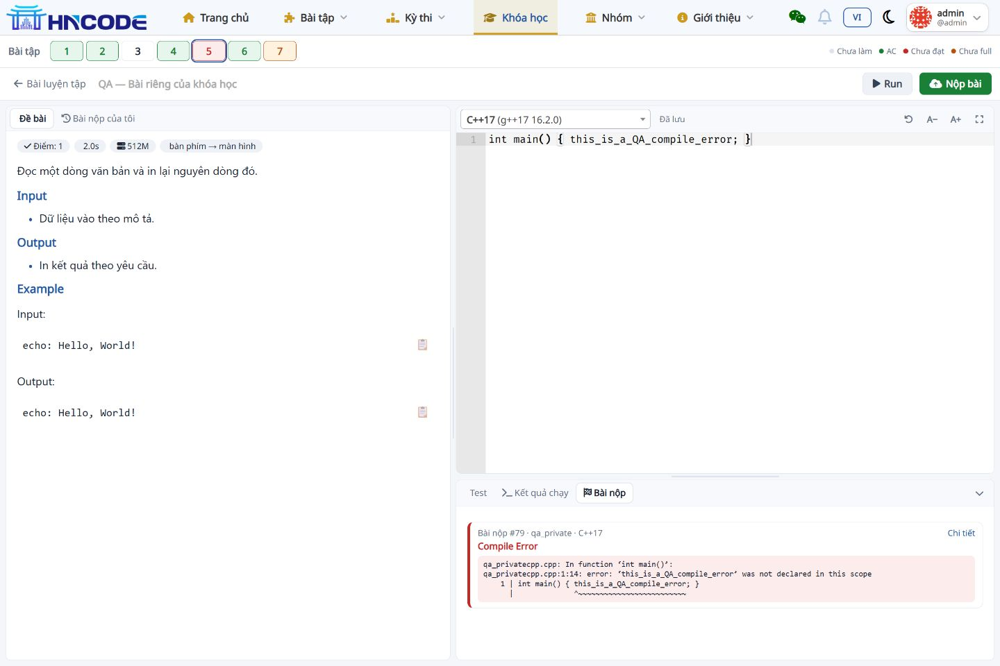
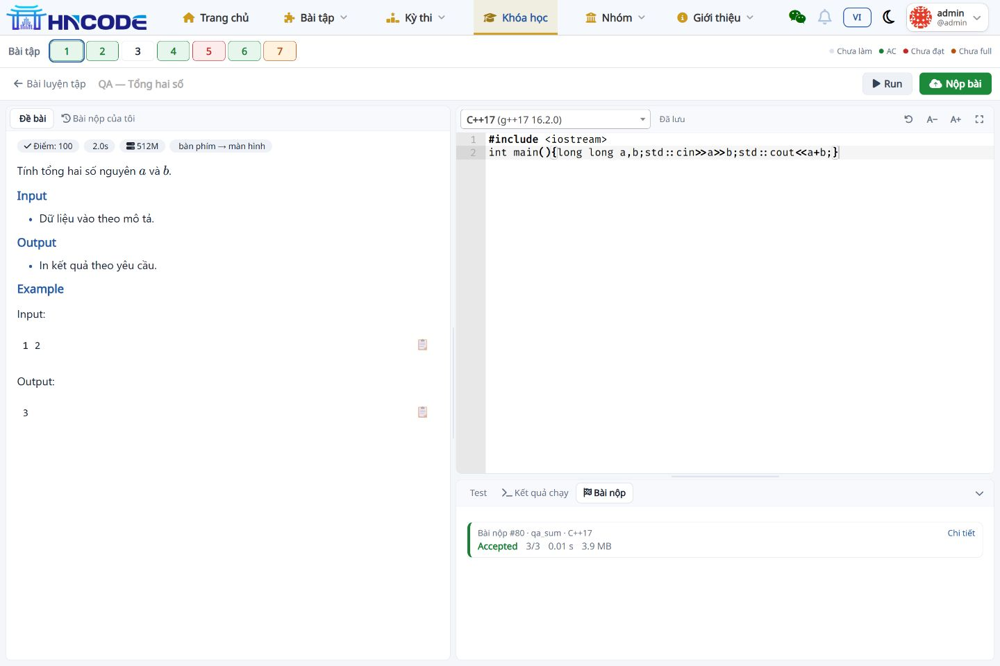
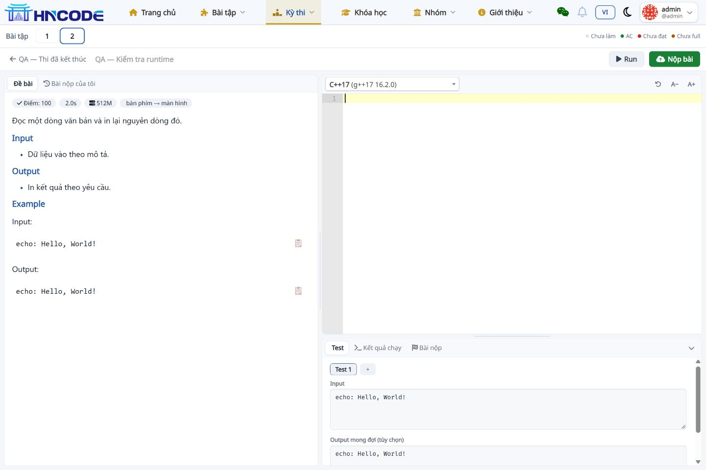
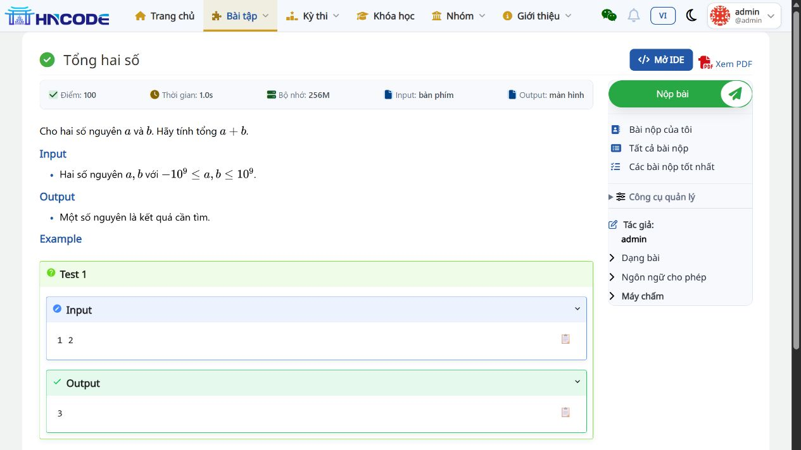

# Bổ sung giao diện IDE và trang đề bài

**Ngày 14/11/2026 · Đã triển khai local, chờ team review/QA trước khi merge**

| Phiên bản | Giá trị |
|---|---|
| Nhánh | codex/backlog-20261113 |
| Base của đợt UI | 02b6d7d |
| Commit code UI | 96acf0453816e480a8b5ec173860c0c6345ff13f |
| Bộ cài local | D:\AI-Code\Build_HNCode |
| Checkout review | D:\AI-Code\Build_HNCode\.local\worktrees\backlog-20261113 |

## 1. Hành vi đã triển khai

### Thanh chuyển bài trong IDE

Thanh số đặt ngay dưới menu chính, dùng thứ tự bài trong Lesson/Contest. Mỗi ô có tên bài và trạng thái qua tooltip/aria-label, ô đang mở có viền riêng để giữ nguyên màu kết quả.

| Trạng thái | Màu và quy tắc |
|---|---|
| Chưa làm | Mặc định; chưa có bài nộp đã kết thúc |
| AC toàn bộ | Xanh lá; AC với đủ điểm test, không phải pretest |
| Đã nộp chưa đạt | Đỏ; có bài nộp kết thúc nhưng chưa ghi điểm, gồm CE/WA |
| Chưa full | Cam; có điểm test nhưng chưa AC toàn bộ, gồm AC pretest |
| Kết quả bị ẩn | Trung tính, nét đứt; không suy ra điểm từ màu |

Màu được tổng hợp theo kết quả tốt nhất của **chính tài khoản đang xem**. AC trước đó được giữ khi nộp thêm WA. Trong Contest, chỉ lấy bài nộp của Contest đó; nếu đang thi thì lấy đúng lần tham gia hiện tại. Các submission bị ẩn được loại trước khi tổng hợp.

Khi chấm xong bài nộp trên IDE, client đọc lại trạng thái từ server và cập nhật màu, giữ nguyên bài đang mở. Thanh số cuộn ngang trên màn hình hẹp; trang không bị kéo rộng theo số lượng ô.

### Giữ ngữ cảnh và kiểm tra quyền

Thêm route `/course/<slug>/lesson/<lesson_id>/problem/<code>/ide`. Các link cũ `/problem/<code>/ide?from=...` được chuyển sang route theo Lesson/Contest khi nguồn cùng host, đúng route và đúng mã bài. Nguồn ngoài host hoặc mã khác không được dùng để chọn ngữ cảnh.

IDE Lesson kế thừa kiểm tra thành viên, bài thuộc Lesson và khóa tiên quyết. IDE Contest kế thừa quyền truy cập Contest và bài thuộc Contest. Contest thường dùng cùng IDE; cơ chế giám sát tiếp tục áp dụng theo phiên thi strict hiện có. Strict IDE vẫn dùng bộ chuyển bài tại chỗ của PR #142.

### Máy chấm và nút Run

Trường máy chấm giữ ẩn, giá trị mặc định rỗng để scheduler chọn máy bất kỳ. Cách kiểm tra giá trị của các caller cũ được giữ lại. Nút chạy trong IDE hiển thị **Run** ở cả màn hình hẹp, thay cho bản dịch “Lần chạy”.

### Trang đề bài

- Thêm nút Mở IDE cạnh tiêu đề; tóm tắt điểm, thời gian, bộ nhớ, I/O gọn trong một khối.
- Desktop đặt đề ở trái, tác vụ ở phải. Trang có sidebar Lesson/Contest tránh thêm cột phụ quá hẹp.
- Mobile đặt nội dung đề trước khối tác vụ/thông tin phụ.
- Thu gọn công cụ quản lý vào details; ngôn ngữ cho phép mặc định đóng, vẫn mở xem được.
- Khu vực nộp bài có khung riêng. Select2 ngôn ngữ co theo khung khi đổi desktop → mobile.
- Giữ link đến trang nộp bài riêng, form nộp ngay dưới đề và nội dung đề/PDF/bình luận theo luồng hiện có.

## 2. File và phạm vi review

| Nhóm | File |
|---|---|
| Route và context | dmoj/urls.py, judge/views/ide.py, judge/views/course.py, judge/views/contests.py |
| Máy chấm mặc định | judge/forms.py |
| IDE và màu trạng thái | templates/problem/ide.html, resources/ide.js, resources/ide.css |
| Trang đề | templates/problem/problem.html, templates/common-content.html, resources/problem-detail.css |
| Test | judge/tests/test_ide_navigation.py, test_ide_run.py, test_contest_strict_views.py |

Không thêm migration hoặc dependency. Static mới `problem-detail.css` và URL CSS/JS liên quan dùng token 20261114b. Khi triển khai cần collectstatic; worker/site/bridge tải code theo quy trình bàn giao.

## 3. Kiểm thử và evidence

| Kiểm tra | Kết quả |
|---|---|
| Toàn bộ judge.tests + chat_box.tests | **1.364 PASS**, 111,539 giây; [log cuối](evidence/ide-ui/full-suite-final.log) |
| Test mới cho thanh số/quyền/trạng thái | **14 PASS**, 1,958 giây; [log](evidence/ide-ui/navigation-tests.log) |
| Nhóm IDE, strict, Lesson/Contest và inline submit | 116 PASS trước khi bổ sung hai case quyền vào nhóm mới |
| Black | 8 file Python được kiểm tra, không cần định dạng lại |
| JavaScript | node --check resources/ide.js đạt |
| Schema | makemigrations --check --dry-run: No changes detected |
| Bài nộp #79 | admin, qa_private, C++17, CE; ô 5 đổi từ mặc định sang đỏ sau chấm, không reload |
| Run | C++17, input 1 2, output 3, Accepted qua judge thật |
| Bài nộp #80 | admin, qa_sum, C++17, AC 3/3 qua judge thật |
| Điều hướng | Lesson và Contest thường/strict mở đúng bài, đúng danh sách; nháp bài tổng khôi phục sau quay lại |
| Mobile 390 px | DOM: bodyWidth 375 <= viewport 390; đề trước sidebar, ngôn ngữ không tràn sau resize; [số đo](evidence/ide-ui/mobile-layout.json) |

Case khóa Lesson ban đầu dùng order=0, bị model tự gán lại thứ tự, khiến cạnh tiên quyết không hợp lệ. Fixture cuối dùng source=1, target=2 và khởi tạo trạng thái khóa, kiểm tra trả 403. Lỗi dựng fixture đã được sửa trước lượt full cuối. Một lượt tổng cũ bị ngắt giữa chừng không được dùng làm bằng chứng full PASS.

Browser QA dùng phiên admin local cho luồng thao tác thật. Quyền học sinh/người ngoài, kết quả ẩn, khóa tiên quyết, pretest và cách ly người dùng được kiểm tra tự động. Team cần nghiệm thu thêm bằng vai trò học sinh trên môi trường của mình, thiết bị thật và theme tối. Reset IDE và các tiêu chí backlog còn tồn đọng tiếp tục theo checklist chính.

## 4. Dữ liệu giữ lại để kiểm tra

Đăng nhập bằng tài khoản admin local đã được cấp nội bộ. Mở [Lesson IDE mẫu](http://localhost:8001/course/qa-ranking-card-1/lesson/8/problem/qa_sum/ide):

| Ô | Bài | Trạng thái của admin lúc bàn giao |
|---|---|---|
| 1 | qa_sum | Xanh, AC; bài nộp bổ sung #80 |
| 2 | local_sum | Xanh, AC |
| 3 | local_max | Mặc định, chưa làm |
| 4 | qa_echo | Xanh, AC |
| 5 | qa_private | Đỏ, CE #79 cố ý tạo để test |
| 6 | qa_float | Xanh, AC |
| 7 | qa_batch | Cam, có điểm phần |

Màu phụ thuộc tài khoản; tài khoản khác có lịch sử khác. Mở [trang đề local_sum](http://localhost:8001/problem/local_sum) để xem bố cục mới. Không đưa mật khẩu/token QA vào tài liệu hoặc PR.

## 5. Ảnh đối chiếu

## 6. Checklist team trước khi merge

- [ ] Đối chiếu thứ tự với Lesson/Contest gốc, thử nhiều bài để kiểm tra cuộn ngang.
- [ ] Kiểm tra default/AC/WA/CE/partial/pretest/hidden và AC rồi nộp WA.
- [ ] Nộp ở một bài, chuyển sang bài khác trước khi chấm xong: màu cập nhật, active marker và form action vẫn đúng bài đang mở.
- [ ] Thử quyền học sinh, người ngoài, Lesson bị khóa và Contest riêng.
- [ ] Kiểm tra chuyển bài khi strict session đã được arm, fullscreen và draft được giữ.
- [ ] Thử máy chấm bất kỳ, Run/Submit nhiều ngôn ngữ, giới hạn nộp và lỗi mạng.
- [ ] Nghiệm thu desktop/mobile/theme tối, tên đề và file I/O dài, đề có PDF/ảnh.
- [ ] Chạy test trên SHA dự kiến merge; kiểm tra static/cache token trên staging trước VPS.

Các điều kiện chờ #109, #124 và trạng thái chưa triển khai #113/#112 giữ nguyên trong [báo cáo tổng](README.md).
