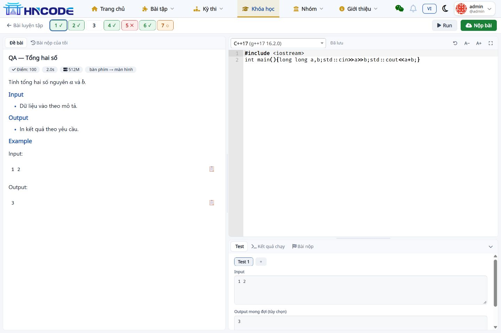
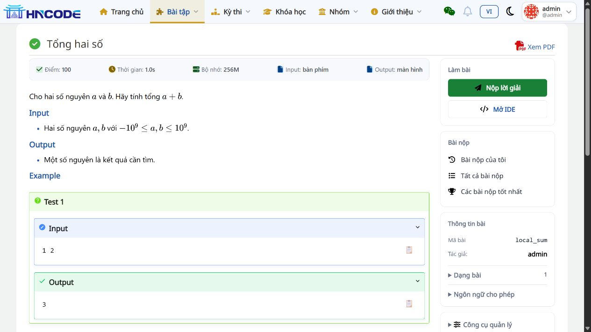
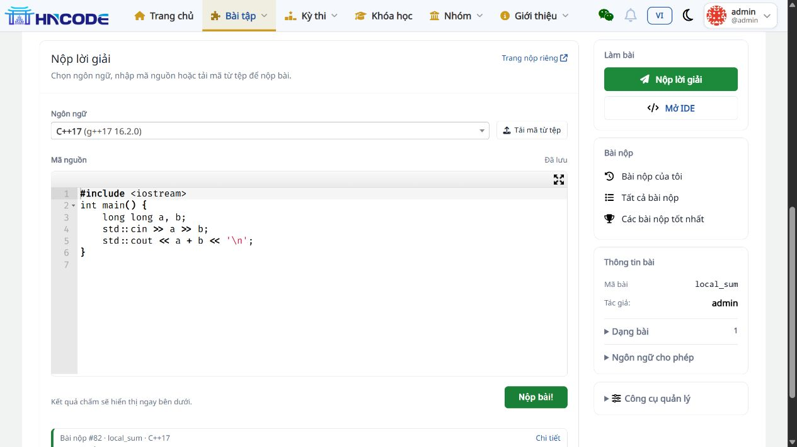
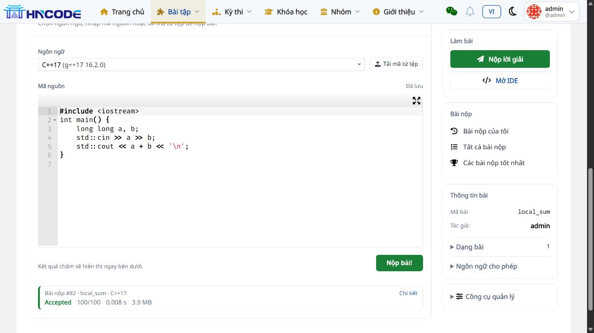

# Cập nhật UI lần 2: thanh IDE, sidebar và form nộp

**14/11/2026 · Code 5284d4d · Nhánh codex/backlog-20261113 · Đã chạy local**

Tài liệu này cập nhật thiết kế trong [báo cáo UI lần đầu](03_GIAO_DIEN_IDE_VA_DE_BAI.md) theo góp ý tiếp theo của chủ dự án. Base của lượt sửa là 4e3c339; commit code hiện tại là 5284d4d835b1d087596e88ad29e6bff4c4ff1011.

## 1. IDE Lesson/Contest

- Gộp đường quay lại, danh sách bài và nút Run/Nộp bài thành **một thanh**, ngay dưới menu.
- Bỏ khối chú thích màu. Tên bài hiện trong vùng đề, nhường chiều ngang cho thanh số.
- AC dùng ✓ xanh; sai/chưa đạt dùng ✕ đỏ; có điểm nhưng chưa full dùng ○ cam; chưa làm không có dấu.
- Giữ viền ô đang chọn, tooltip/tên truy cập, màu theo kết quả tốt nhất và chính sách che kết quả.
- Thanh số cuộn ngang ở màn hình hẹp, giữ Run/Nộp bài trên cùng thanh.

Các dấu được vẽ theo class trạng thái. Khi client cập nhật màu sau chấm, dấu tương ứng cũng đổi; không cần một nguồn trạng thái riêng trên client.

## 2. Sidebar trang đề

Sidebar dùng các nhóm rõ ràng:

| Nhóm | Nội dung |
|---|---|
| Làm bài | Nộp lời giải ngay tại trang, Mở IDE; số lượt còn lại nếu có giới hạn |
| Bài nộp | Của tôi, tất cả, tốt nhất; link Contest dùng ngữ cảnh đang thi |
| Thông tin bài | Mã, tác giả, dạng bài/ngôn ngữ và giới hạn riêng có thể mở xem |
| Công cụ quản lý | Chỉnh sửa, báo cáo, quản lý bài nộp, clone/admin và thông tin judge theo quyền; mặc định thu gọn |

Desktop giữ sidebar ở cột phải khi cuộn; mobile chuyển xuống sau nội dung. Các thao tác quản trị vẫn kiểm tra bằng quyền hiện có. Dạng bài vẫn bị ẩn khi Contest yêu cầu giấu tag.

## 3. Form “Nộp lời giải”

Thay tiêu đề Submit solution bằng “Nộp lời giải”. Form chia thành phần giới thiệu, thanh ngôn ngữ/tải tệp, editor và thanh nộp. Nút “Trang nộp riêng” giữ đường truy cập tới trang submit đầy đủ.

Khi chọn tệp mã nguồn, nội dung được tải vào editor bằng luồng xử lý hiện có. Trường chọn judge tiếp tục ẩn, scheduler tự chọn. Submit vẫn gửi về endpoint kiểm tra hiện có, kết quả hiện dưới form và toast giữ theo chức năng A26.

Form nộp riêng tiếp tục dùng markup cũ; form gọn chỉ dùng cho nộp ngay tại trang. Không thay cấu trúc dữ liệu, quyền nộp, giới hạn nộp hay định dạng code/output-only/Scratch được server hỗ trợ.

## 4. Kiểm thử và dữ liệu giữ lại

| Kiểm tra | Kết quả |
|---|---|
| Toàn bộ judge.tests + chat_box.tests | **1.364 PASS**, 116,201 giây; [log](evidence/ide-ui-v2/full-suite-final.log) |
| Nhóm IDE/inline submit/strict views | **88 PASS**, 7,416 giây; [log](evidence/ide-ui-v2/tests.log) |
| Toolbar IDE | 1 header; không còn legend; DOM xác nhận ✓/✕/○/không dấu đúng trạng thái |
| IDE ở 390 px | Body 375 px, toolbar khoảng 46,57 px; thanh số có cuộn ngang; [số đo](evidence/ide-ui-v2/ide-mobile-layout.json) |
| Form ở 390 px | Body 375 px; editor/ngôn ngữ khoảng 312,74 px, nút nộp hiển thị; [số đo](evidence/ide-ui-v2/mobile-layout.json) |
| Nộp từ tệp | [qa_submit_sum.cpp](evidence/ide-ui-v2/qa_submit_sum.cpp) vào editor; **#81 AC 100/100** |
| Nộp mã sau tải lại | **#82 AC 100/100**, trả ngay dưới form; judge local-judge-1 |
| Điều hướng | Chuyển bài Lesson/Contest, tên bài nằm đúng vùng đề và giữ ngữ cảnh |

Các submission #79 CE, #80 AC từ lượt UI đầu vẫn giữ nguyên. Đăng nhập tài khoản admin local để xem đủ màu trong [Lesson mẫu](http://localhost:8001/course/qa-ranking-card-1/lesson/8/problem/qa_sum/ide). Bài #81/#82 ở [trang local_sum](http://localhost:8001/problem/local_sum).

Browser QA dùng admin local; các test quyền/hạn mức/ẩn kết quả vẫn nằm trong bộ test tổng. Team tiếp tục thử vai trò học sinh, thiết bị thực tế, theme tối, file output-only/Scratch và strict session đã arm theo checklist release. Không có migration hoặc dependency mới; CSS/JS dùng cache token 20261114c.

## 5. File cần review

| File | Vai trò |
|---|---|
| templates/problem/ide.html, resources/ide.css | Toolbar một dòng, dấu trạng thái và tên bài |
| templates/problem/detail-sidebar.html | Nhóm thao tác/thông tin và điều kiện quyền |
| templates/problem/submit-form-compact.html | Form nộp ngay tại trang |
| templates/problem/submit-form.html | Chọn form gọn hoặc form riêng theo context |
| templates/problem/problem.html, resources/problem-detail.css | Bố cục sidebar, tiêu đề và khu vực nộp |
| test_inline_submit_form.py, test_ide_navigation.py | Cập nhật kỳ vọng về link nộp trong trang, giữ đường tới trang submit riêng |

## 6. Ảnh đối chiếu

Đợt này chỉ cập nhật local và nhánh review. Các tiêu chí backlog chưa nghiệm thu, #109 chờ key, #124 chờ dữ liệu thật, #113/#112 chưa triển khai vẫn giữ nguyên; xem [báo cáo tổng](README.md).
