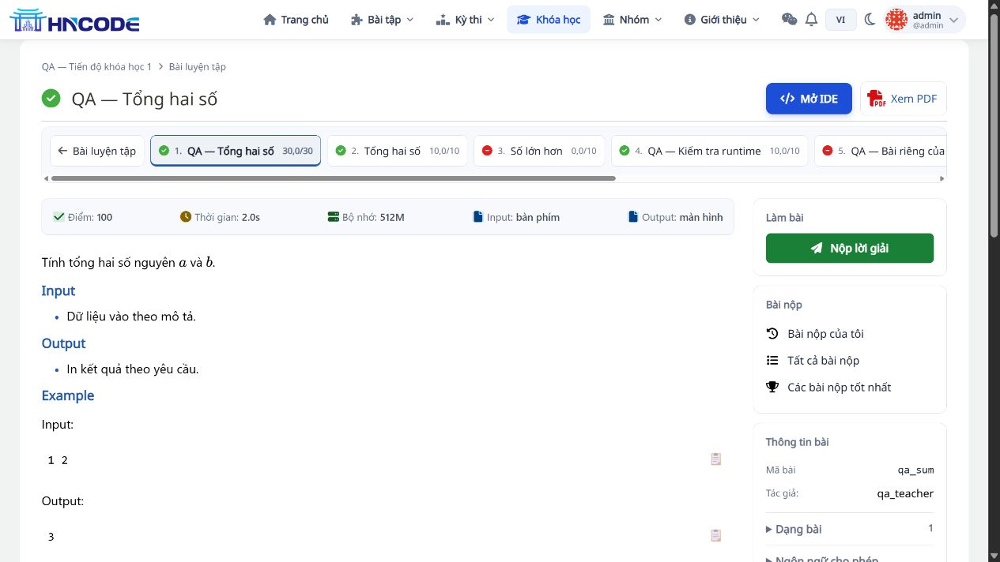
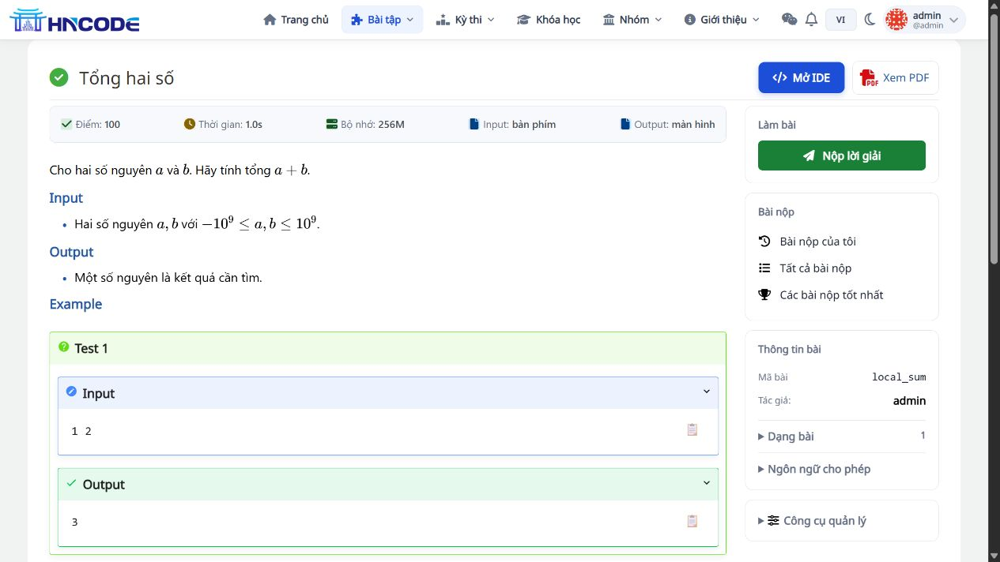
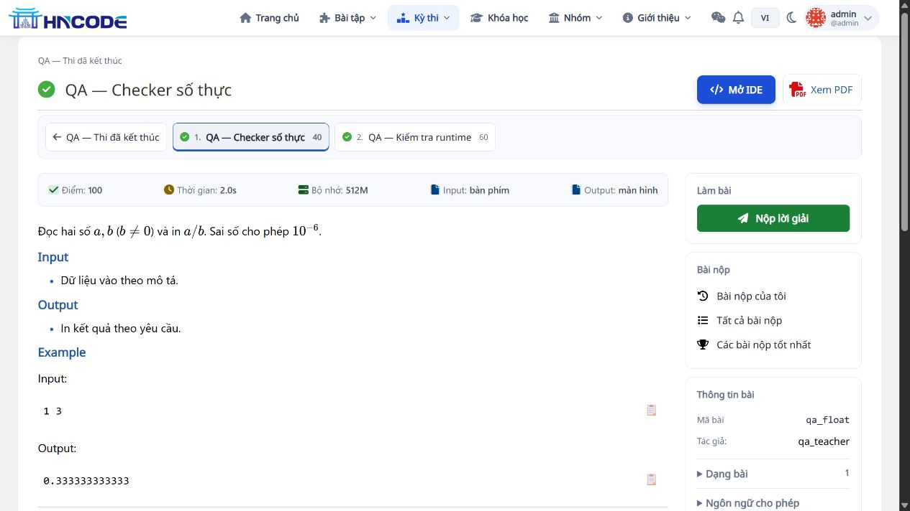
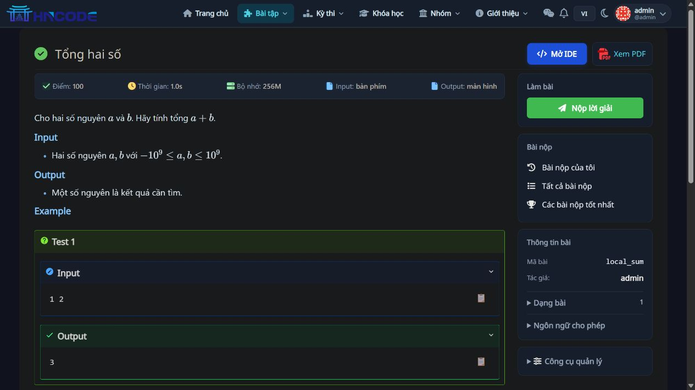

# UI lần 3: nút Mở IDE, bố cục Lesson/Contest và menu

**14/11/2026 · Code d21c202 · Nhánh codex/backlog-20261113 · Đã cập nhật local**

Base của lượt này là f32f99c. Commit code: d21c202ce554e36ac2b48a4fcb8b94a94cf72336. Tài liệu này bổ sung và cập nhật [thiết kế lần 2](04_TINH_GON_IDE_SIDEBAR_FORM.md).

## 1. Thay đổi theo yêu cầu

| Yêu cầu | Hành vi mới |
|---|---|
| Làm nổi Mở IDE | Nút nền xanh, chữ trắng đậm, biểu tượng code, chiều cao tối thiểu 40px, trạng thái hover/focus rõ |
| Đặt cạnh Xem PDF | Hai nút thành nhóm thao tác trên đầu trang đề thường và đề trong Lesson/Contest; bỏ nút IDE trùng trong sidebar |
| Bố cục đề trong Lesson/Contest | Hiển thị đường dẫn khóa học/bài học hoặc Contest trước tên đề; danh sách bài thành dải ngang có STT và cuộn riêng |
| Tối ưu vùng đọc | Desktop dùng hai cột đề/tác vụ; loại bố cục ba cột hẹp và tránh đẩy tác vụ xuống cuối trang |
| Làm mới menu | Menu icon/chữ dùng trạng thái chọn nền xanh nhẹ, bo góc, icon nhất quán, logo/tài khoản gọn và dropdown có khung/đổ bóng |
| Màn hình hẹp | Menu thu gọn theo breakpoint hiện có; tên HNCode cạnh hamburger, danh sách bài cuộn ngang; nhóm IDE/PDF xuống dòng khi cần |

Menu giữ các route, ID và JavaScript dropdown/drawer hiện có. Thêm mở dropdown bằng focus-within để điều hướng bằng bàn phím. Thiết kế mới áp dụng biến thể menu icon/chữ `nav-v3` đang dùng trên HNCode; các biến thể menu cũ tiếp tục theo stylesheet riêng của chúng.

Tên tab trình duyệt vẫn giữ Lesson/Contest; tiêu đề trên trang chỉ hiện tên bài, tránh lặp tên ngữ cảnh. Nội dung đề, metadata, giới hạn/quyền và form nộp đã có được giữ theo luồng hiện tại.

## 2. Kiểm thử và giới hạn

| Kiểm tra | Kết quả |
|---|---|
| Nhóm Lesson/Contest/inline submit/menu cache/IDE/strict views | **59 test PASS**, 7,968 giây; [log](evidence/ide-ui-v3/tests-final.log) |
| Desktop 1280 px | Vùng đề khoảng 886,54px; IDE và PDF cùng nhóm ở đầu; [số đo](evidence/ide-ui-v3/desktop-layout.json) |
| Tablet 800 px | Body và menu 785px, không tràn ngang; menu cao khoảng 50,57px |
| Mobile 390 px | Body/menu 375px; nhóm thao tác khoảng 332,41px; danh sách bài cuộn riêng |
| Nút Mở IDE ở Lesson | Mở đúng `/course/qa-ranking-card-1/lesson/8/problem/qa_sum/ide` |
| Nút Mở IDE ở đề thường | Mở đúng `/problem/local_sum/ide?from=/problem/local_sum` |
| Trang Contest | Bố cục, tên đề và nút IDE/PDF hiển thị đúng ở qa_rank_past/qa_float |
| Menu mobile | Hamburger mở/đóng được drawer, các mục hiển thị; không làm thay đổi viewport trang |
| Bàn phím | Tab từ Bài tập vào mục Bài nộp trong dropdown, menu con hiện rõ |
| Theme tối | Menu, nút IDE và trang đề hiển thị rõ; đã khôi phục theme ban đầu sau kiểm tra |

Lượt này chỉ sửa template/CSS, không thêm migration/dependency/logic chấm và không tạo submission mới. Chạy bộ test phù hợp với phạm vi; **không chạy lại toàn bộ 1.364 test** trong lượt UI lần 3. Kết quả toàn hệ thống lần 2 là 1.364 PASS, được giữ ở báo cáo trước.

Browser QA dùng admin local; các kiểm tra quyền route vẫn thuộc nhóm test tự động. Team cần nghiệm thu thêm tên khóa/đề dài, số lượng bài lớn, role học sinh và các trình duyệt/thiết bị mục tiêu. PDF giữ handler/route cũ, chưa thực hiện thao tác in trong lượt này.

## 3. Phạm vi source và triển khai

| File | Vai trò |
|---|---|
| templates/base.html, resources/navigation.css | Nạp và áp dụng menu mới |
| templates/problem/problem.html, resources/problem-detail.css | Breadcrumb, tiêu đề, nhóm IDE/PDF và cột đề/tác vụ |
| templates/problem/problem-sidebar-media.html | Dải danh sách bài ngang |
| templates/problem/problem_in_lesson.html | STT trong dải Lesson |
| templates/contest/contest-problem-sidebar.html | STT trong dải Contest |
| templates/problem/detail-sidebar.html | Bỏ đường vào IDE trùng, giữ Nộp lời giải |

Static mới navigation.css và problem-detail.css dùng cache token **20261114d**. Trên local đã collectstatic và restart web. Trên staging/VPS áp dụng quy trình release và kiểm tra CDN/static trước nghiệm thu. Không có thay đổi cấu hình máy chấm hoặc DB trong lượt này.

## 4. Ảnh giao diện

Các issue chờ điều kiện và nghiệm thu backlog giữ nguyên: #109 chờ key, #124 chờ dữ liệu thật, #113/#112 chưa triển khai. Lượt này chưa xuất bản PR mới, merge hoặc deploy VPS.
