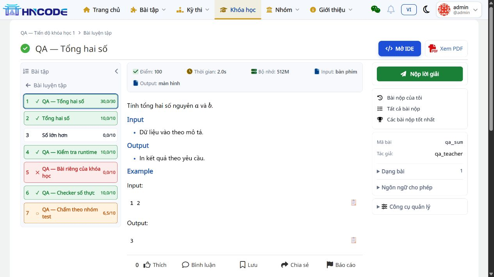
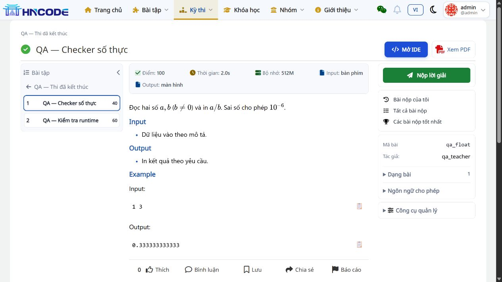
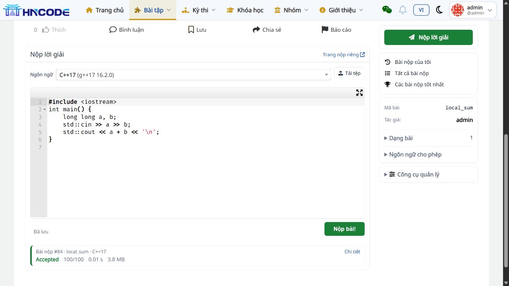

# UI lần 4 — Menu cũ, cột bài bên trái và form nộp gọn

Ngày cập nhật: 14/11/2026. Code mới nhất: `2a19d1102be9ba7e0db5b12410c858fe81182d8e`, nhánh `codex/backlog-20261113`; nối tiếp sửa menu/form tại `7ce56f8`. Bản này thay thế thiết kế menu mới và dải bài ngang của UI lần 3. Đã áp dụng trên bộ cài local `D:\AI-Code\Build_HNCode`, tại `http://localhost:8001/`.

## 1. Thay đổi theo yêu cầu

| Yêu cầu | Kết quả |
|---|---|
| Trả menu về kiểu cũ, chỉ căn logo | Bỏ stylesheet thiết kế lại menu; giữ menu gốc, căn logo giữa theo chiều dọc và giới hạn cao 34px |
| Danh sách bài ở cột trái Lesson/Contest | **Mặc định mở rộng: STT, tên bài, điểm** theo thứ tự bài; có liên kết quay về Lesson/Contest |
| Khi bấm thu gọn | Chỉ còn ô số, màu và biểu tượng; **vẫn giữ các ô để chuyển bài**, không ẩn cả danh sách |
| Màu và biểu tượng | Xanh ✓: AC đầy đủ; đỏ ✕: đã nộp nhưng chưa đạt; cam ○: có điểm nhưng chưa đầy đủ; mặc định không dấu: chưa có kết quả chấm hoàn tất |
| Bỏ ba tiêu đề ở cột phải | Bỏ chữ “Làm bài”, “Bài nộp”, “Thông tin bài”; giữ các nút, liên kết và dữ liệu |
| Thu gọn dưới “Nộp lời giải” | Giảm khoảng cách, gom chọn ngôn ngữ và tải tệp, bỏ hướng dẫn lặp, đặt trạng thái nháp cạnh nút nộp |

Nút **Mở IDE** tiếp tục nằm cạnh **Xem PDF** ở đầu trang. Tên bài và trạng thái vẫn có trong tooltip và nhãn hỗ trợ trình đọc màn hình khi thu gọn. Nút thu/mở dùng được bằng chuột và bàn phím, cập nhật `aria-expanded`. Tải trang mới mặc định mở rộng. Trên màn hình nhỏ, danh sách đầy đủ xếp trên vùng đề để giữ khả năng đọc; khi thu gọn, các ô số nằm bên trái vùng đề.

## 2. Quy tắc dữ liệu và phạm vi

- Trang đề và IDE dùng chung `mark_navigation_states()` trong `judge/utils/problem_navigation.py`, tránh sai khác cách đánh dấu.
- Trạng thái lấy kết quả tốt nhất của tài khoản hiện tại. Bài đang đợi/chấm không thay kết quả đã hoàn tất.
- Trong Contest, lọc bài nộp theo Contest và lượt tham gia hiện tại nếu đang thi. Bài nộp ngoài Contest không dùng để tô trạng thái trong Contest.
- Kết quả bị ẩn tiếp tục tuân theo chính sách hiện có; không hiện dấu/màu tiết lộ kết quả.
- Không thay endpoint nộp, cơ chế nháp, tải tệp hoặc xử lý chấm. Không thêm dependency hay migration trong lượt UI này.

## 3. File cần review

| Nhóm | File |
|---|---|
| Menu/logo | `templates/base.html`, `resources/logo-alignment.css`; xóa `resources/navigation.css` khỏi nhánh review |
| Cột bài | `templates/problem/navigation-rail.html`, `templates/problem/problem-sidebar-media.html`, template Lesson/Contest |
| Trạng thái dùng chung | `judge/utils/problem_navigation.py`, `judge/views/course.py`, `judge/views/contests.py`, `judge/views/ide.py` |
| Sidebar và form | `templates/problem/detail-sidebar.html`, `templates/problem/submit-form-compact.html`, `templates/problem/problem.html`, `resources/problem-detail.css` |
| Hồi quy | `judge/tests/test_ide_navigation.py`: đối chiếu bốn trạng thái giữa trang đề và IDE |

CSS dùng cache token `20261114e`. Khi triển khai môi trường khác, thực hiện quy trình static và restart ứng dụng theo cấu hình của môi trường đó.

## 4. Kết quả kiểm tra

| Kiểm tra | Kết quả |
|---|---|
| Nhóm test liên quan tại 7ce56f8 | **55 PASS**, 7,376 giây; [log](evidence/ide-ui-v4/tests.log) |
| Toàn bộ `judge.tests chat_box.tests` tại 2a19d11 | **1.364 PASS**, 126,956 giây, chạy lại sau khi sửa hai chế độ; [log](evidence/ide-ui-v4/full-suite-final.log) |
| Định dạng Python và diff | Black 5 file PASS; `git diff --check` PASS |
| Trang đề Lesson/Contest | Cột trái, ô trạng thái, chuyển bài, thu/mở cột hoạt động; ba tiêu đề cột phải đã bỏ |
| Thu gọn ở viewport 1280px | Cột trái 260 → 72px; vẫn hiện đủ ô bài và dấu trạng thái; mở lại hiện tên và điểm |
| Viewport 390px | Hai chế độ không tràn ngang trang; danh sách đầy đủ rộng khoảng 348px phía trên đề, thu gọn thành cột trái 48px; [số đo](evidence/ide-ui-v4/mobile-layout.json) |
| Nộp qua form gọn | Submission **#84 AC 100/100**, kết quả hiện ngay dưới form; giữ trên local để kiểm tra |
| Dịch vụ local | Web/DB/gateway healthy, bridge/worker và hai judge đang chạy |

Một số test chủ động giả lập lỗi dịch vụ nên log có traceback; kết luận bộ test là dòng `OK` cuối log. Kiểm tra trình duyệt thực hiện bằng tài khoản admin trên dữ liệu QA; team tiếp tục nghiệm thu các vai trò và quy tắc ẩn kết quả theo checklist chung.

## 5. Ảnh đối chiếu

## 6. Bàn giao và giới hạn

Đã cập nhật local và commit vào nhánh review. Chưa push, tạo PR, merge hay triển khai VPS. Mọi file bàn giao và bằng chứng của lượt này nằm trên ổ D.

Các trạng thái backlog không thay đổi: #109 chờ API key, #124 chờ ngân hàng bài thật trên DB, #113 và #112 chưa triển khai. Các tiêu chí nghiệm thu còn lại nằm trong [README bàn giao](README.md) và [checklist](01_KIEM_THU_VA_NGHIEM_THU.md).
