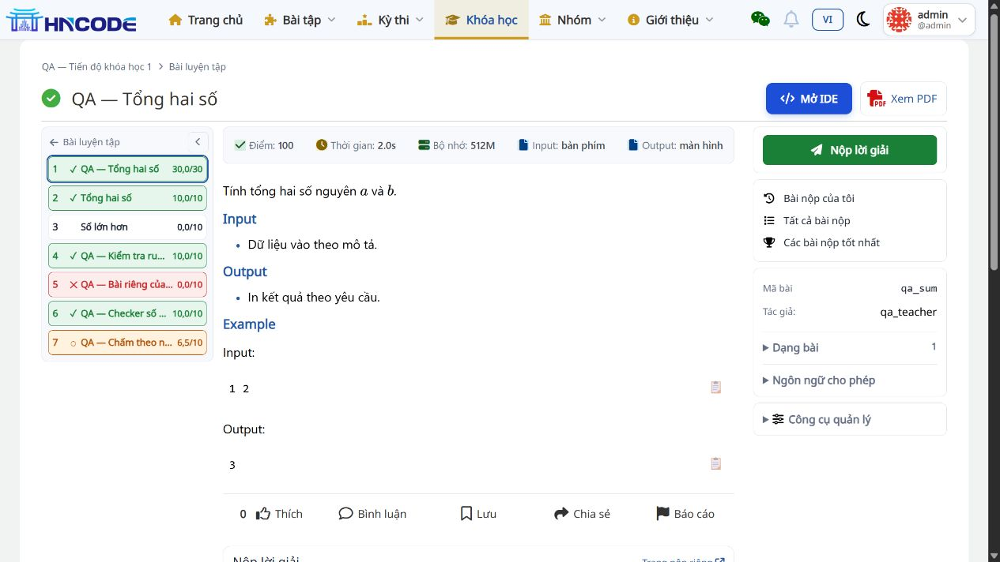
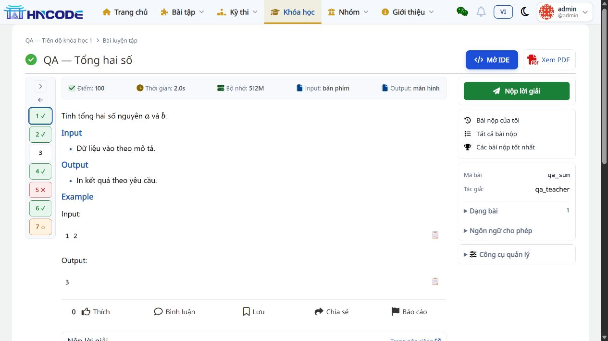
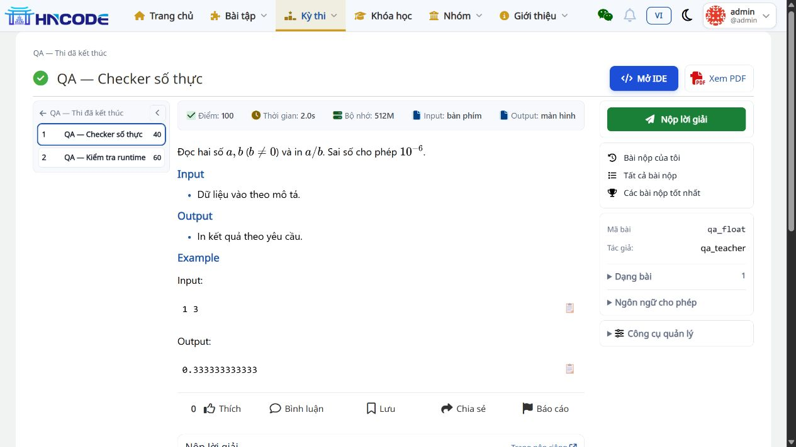

# UI lần 5 — Cột bài gọn, mỗi bài một dòng

Ngày 14/11/2026. Code `9579d6b5d2f2cc27069b69f236851058275e5076`, nhánh `codex/backlog-20261113`. Đã áp dụng tại bộ cài local `D:\AI-Code\Build_HNCode`.

## Thay đổi

- Cột bài Lesson/Contest rộng 220px thay cho 260px trên desktop; 200px ở breakpoint tablet. Khi thu gọn, cột số rộng 64px trên desktop, 48px trên mobile.
- Mỗi bài cao 32px và chỉ có một dòng: STT, dấu trạng thái, tên bài, điểm. Tên vượt chiều rộng dùng `text-overflow: ellipsis`; tooltip và nhãn hỗ trợ đọc vẫn giữ tên đầy đủ.
- Bỏ dòng tiêu đề “Bài tập” và icon danh sách ở đầu cột. Nút thu/mở chỉ dùng dấu mũi tên, đặt cùng hàng với liên kết quay về Lesson/Contest.
- Giữ mặc định mở rộng, màu và dấu trạng thái, điểm và liên kết chuyển bài. Không thay logic dữ liệu, dependency hoặc DB.

## Kiểm tra

- **24 test PASS**, 5,026 giây: `test_ide_navigation`, `test_lesson_problem_page`, `test_problem_contest_sidebar`; [log](evidence/ide-ui-v5/tests.log).
- Trình duyệt: Lesson có 7 hàng và Contest có 2 hàng, tất cả cao 32px. Tên dài được cắt bằng dấu ba chấm, tên ngắn hiện đầy đủ. Cột Lesson đo được 220px; [số đo](evidence/ide-ui-v5/layout-checks.json).
- Thu gọn vẫn hiện đủ ô số và các dấu trạng thái; mở lại bằng phím Space hoạt động.
- `git diff --check` PASS. Lượt UI này chỉ sửa hai template/CSS; full suite gần nhất vẫn là 1.364 PASS tại `2a19d11`, không ghi nhận là chạy lại cho lượt 5.

Báo cáo này cập nhật kích thước và header của [UI lần 4](06_MENU_CU_VA_COT_BAI_THU_GON.md). Gói ZIP UI_V4 đã bàn giao là mốc lịch sử trước lượt này; nhánh review local chứa code mới nhất. Chưa push, merge hoặc triển khai VPS.
