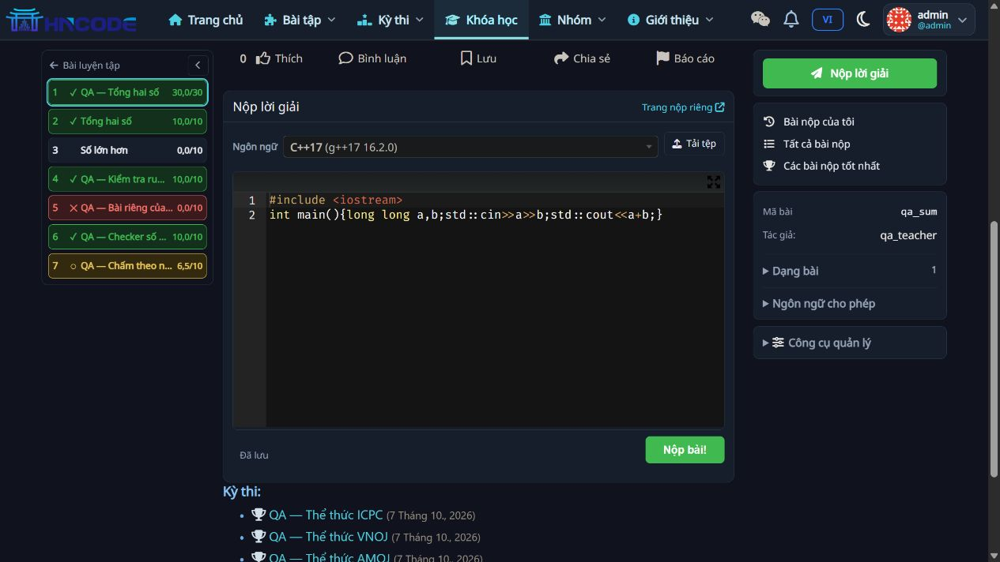
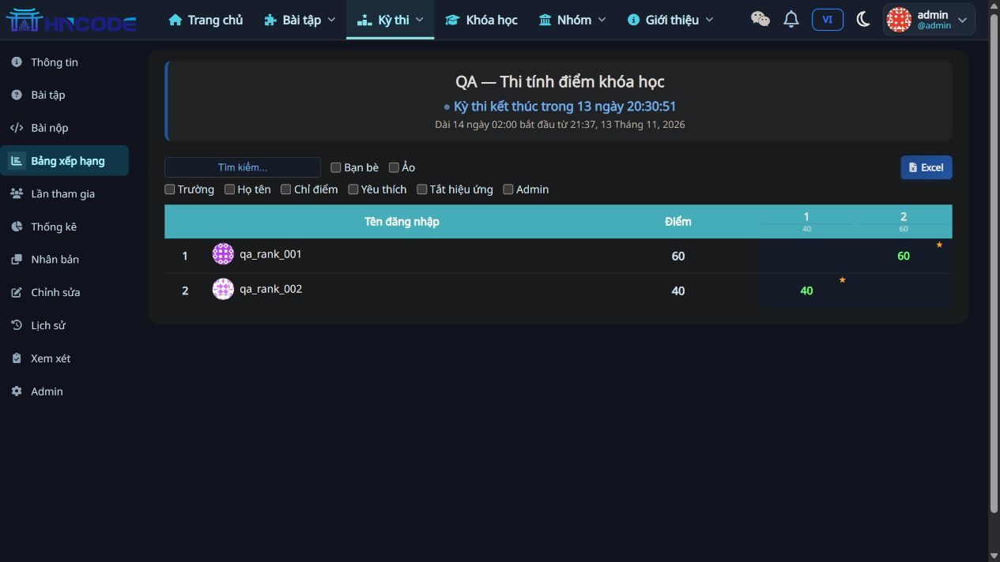
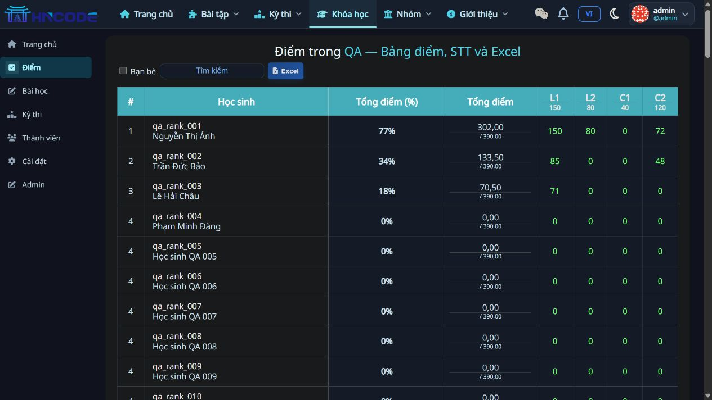
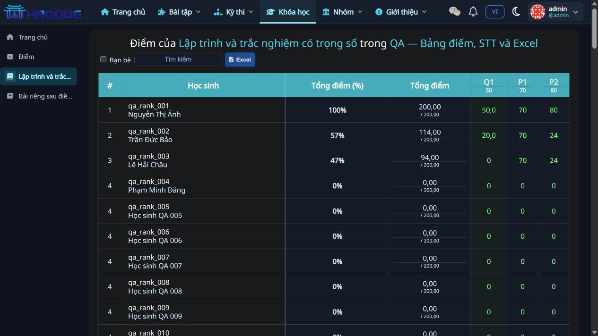

# RC2 — Nền trang xanh sẫm, editor tối và xuất Ranking XLSX

Ngày 14/11/2026. Nhánh `mrtee-hncode-v1.0.0-rc.2`. Code `415e672a1dccf95e3bbefaddb9982c98bbb1f40e`, kế thừa đầy đủ RC1 tại `c9fea49`.

## 1. Kết quả theo yêu cầu

| Yêu cầu | Kết quả |
|---|---|
| Ô nhập code không trắng khi trang dark | Editor mặc định chuyển sang theme Twilight theo trang tối, đồng nhất quy tắc IDE; tôn trọng cấu hình màu code riêng của tài khoản |
| Nền chung vẫn xanh sẫm | Giữ palette hiện có `--dk-bg`; bổ sung vùng `#content` vào nền xanh sẫm để tránh nền đen của CSS dark nền tảng ghi đè |
| Contest xuất Ranking tương tự Course/Lesson | XLSX đầy đủ các dòng theo bộ lọc, không giới hạn trang hiện tại, có tiếng Việt, tổng điểm, trạng thái và điểm từng bài/quiz |
| Nút xuất gọn ở cả ba nơi | Dùng cùng stylesheet, icon Excel + chữ “Excel”; tooltip/aria-label “Xuất Ranking (Excel)”; chiều cao 30px |
| Lỗi % Excel đã biết từ RC1 | Course/Lesson lưu tỷ lệ 0–1 và number format `0.00%`, tổng điểm vẫn là số |

Đo trình duyệt: nền trang `rgb(16,19,30)` — `#10131e`; khung form `rgb(23,30,43)` — `#171e2b`; riêng editor `rgb(20,20,20)` — `#141414`. [Số đo](evidence/rc2/dark-colors.json).

## 2. Quyền và dữ liệu Contest

- Nút XLSX xuất hiện cho người có quyền sửa Contest và quyền xem bảng đầy đủ. Endpoint `?format=xlsx` kiểm tra lại quyền; học sinh/người ngoài không được tải XLSX bằng cách tự gõ URL.
- Dùng cùng query/order, cách tính hạng và bộ lọc của bảng web: tìm kiếm, bạn bè, yêu thích, tham gia ảo. Bấm tải lấy trạng thái bộ lọc hiện tại, kể cả sau cập nhật AJAX; bỏ tham số trang.
- Bảng thường xuất `score` và che cột kết quả ẩn bằng `?`; chưa nộp giữ ô trống. Bảng final xuất `score_final`, chỉ khi được phép xem final và Contest có kết quả ẩn theo quy tắc hiện có.
- Kiểm tra quyền final cũng áp dụng cho đường CSV cũ, tránh tải file final qua query string mà bỏ qua kiểm tra ở trang HTML. CSV thường giữ endpoint cũ để tương thích; giao diện người quản lý chuyển sang XLSX.
- Họ tên lấy từ `User.first_name`, trường từ `User.last_name`, theo quy ước bảng Contest hiện có. Điểm là số; chuỗi người dùng bắt đầu bằng `=` được ghi kiểu text để không trở thành công thức Excel.
- Không bổ sung migration/dependency; dùng `openpyxl` đã thêm trong RC1. Các tên file dùng key/slug hệ thống.

## 3. Kiểm thử

**Full suite: 1.370 PASS, 142,313 giây** — [log](evidence/rc2/full-suite-final.log). Sáu test bổ sung gồm năm test Contest XLSX và một test tỷ lệ/format phần trăm. Black 5 file và `git diff --check` đạt.

| Nhóm | Phạm vi được kiểm tra |
|---|---|
| Contest XLSX | Unicode, tổng điểm, đồng hạng, cột ẩn/ô trống, quiz, phân trang, search, favorites, friends, virtual, manager/admin, từ chối student/anonymous/private, quyền final với XLSX và CSV |
| Course/Lesson | Tỷ lệ và format %, tổng điểm, Unicode, quyền, bộ lọc và số dòng; giữ regression trước đó |
| Trình duyệt | Editor tối trên nền xanh sẫm; nút Excel gọn tại Course/Lesson/Contest; tải thật ba file và xuất Contest sau khi gõ bộ lọc |
| File tải thật | Course 103 học sinh; Lesson 103 học sinh; Contest 2 người; file lọc chỉ có `qa_rank_002`; freeze `D2`, dữ liệu số và không có ô công thức |

[Kết quả kiểm tra workbook](evidence/rc2/xlsx-checks.json). Excel Course ghi 302/390 thành giá trị khoảng `0.7743589744`, định dạng `0.00%`; Lesson 200/200 ghi `1`, hiển thị `100.00%` theo locale Excel. Đã xác minh bằng openpyxl; **chưa nghiệm thu trực tiếp trong Microsoft Excel**.

Một số test giả lập lỗi dịch vụ ghi traceback; kết luận cuối log là `OK`. Các lượt target trước đó dùng để sửa fixture test; bằng chứng nghiệm thu RC2 là log full suite cuối. Không tạo thêm bài nộp qua judge trong RC2; dữ liệu QA và bài nộp cũ được giữ. Sau restart, web/DB/gateway healthy, hai judge online và hàng đợi không còn bài đang chấm.

## 4. File cần review

- `templates/problem/submit-form-media-js.html`, `resources/problem-detail.css`: theme editor và khung nộp; giữ nháp, upload, endpoint nộp.
- `resources/darkmode-theme.css`, `templates/base.html`: nền xanh sẫm và cache token.
- `judge/views/contests.py`, `judge/tests/test_contest_ranking_export.py`: XLSX, scope bộ lọc/quyền và kiểm tra final.
- `judge/utils/grades_export.py`, `judge/views/course.py`, `judge/tests/test_grades_export.py`: format % đúng và giữ tổng điểm dạng số.
- `resources/ranking-export.css`, ba template Ranking: nút dùng chung; Contest lấy bộ lọc hiện tại khi tải.

Static cache token RC2 là `20261114rc2`. Môi trường đích cần cập nhật static và restart ứng dụng theo quy trình của team. Nút Course/Lesson vẫn chỉ dành cho người quản lý theo quyền cũ.

## 5. Ảnh và file đối chiếu

- [Contest XLSX](evidence/rc2/ranking-contest.xlsx), [Contest đã lọc](evidence/rc2/ranking-contest-filtered.xlsx).
- [Course 103 học sinh](evidence/rc2/ranking-course-103.xlsx), [Lesson 103 học sinh](evidence/rc2/ranking-lesson-103.xlsx).

## 6. Bàn giao

Gửi gói **`HNCODE_MRTEE_v1.0.0-rc.2_BAN_GIAO.zip`**, thay RC1 làm bản review hiện tại. Bundle đầy đủ từ base `e665d7b`, kèm patch, manifest, báo cáo và evidence. Nhánh RC1 vẫn giữ nguyên; nhánh RC2 mới ở local, chưa push/PR/merge/VPS. Xem [hướng dẫn dev](08_GUI_DEV_VA_QUAN_LY_NHANH.md).

#140 đã sửa lỗi scale/format %, vẫn cần nghiệm thu Excel thực tế và checklist chung. #109 chờ key; #124 chờ ngân hàng bài trên DB; #113/#112 chưa triển khai. Các mục Reset, benchmark, polling và tích hợp client API tiếp tục chờ nghiệm thu. Không tự đóng issue trong lượt này.
