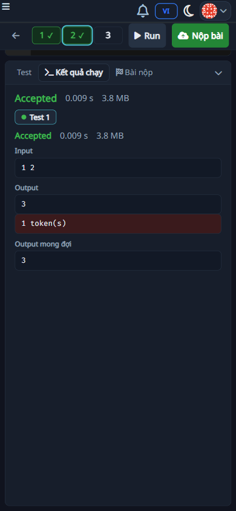
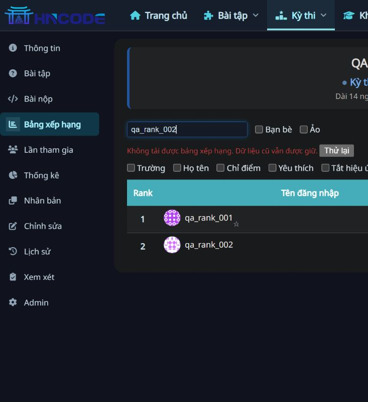

# RC3 — Hoàn thiện trải nghiệm và giảm truy vấn Profile

Ngày 14/11/2026 · Nhánh `mrtee-hncode-v1.0.0-rc.3` · code `b5da9b373374d4e826de7b14ad58a7c71ad1c509`.

## 1. Phạm vi và kết quả

RC3 kế thừa RC2. Đã áp dụng lên bộ cài `D:\AI-Code\Build_HNCode` tại [localhost](http://localhost:8001/). Chưa push/PR/merge hoặc triển khai VPS. Không thêm migration hay dependency so với RC2.

| Hạng mục | Trước sửa | Hành vi RC3 / phạm vi |
|---|---|---|
| Run/Submit mobile | Kết quả Run dưới viewport, dễ tưởng chưa chạy | Khi bấm, mở vùng kết quả và cuộn một lần tới vùng đó. Dành đủ chiều cao từ lúc xếp hàng để tránh giới hạn cuộn; không giành lại vị trí khi kết quả bất đồng bộ tới |
| Cột bài Lesson/Contest | Thu gọn rồi chuyển bài thì bung lại | Giữ trạng thái khi điều hướng AJAX giữa các bài cùng lesson/contest; không lưu xuyên phiên/tải lại trang |
| Chuyển bài nhanh | AbortController không hủy được jqXHR của jQuery | Hủy jqXHR thật, đánh số lượt điều hướng, bỏ response cũ; giữ nội dung trong khi tải, có aria-busy |
| Ranking rỗng | Chỉ có tiêu đề bảng | Phân biệt chưa có dữ liệu và bộ lọc không khớp; có hành động xóa lọc |
| Ranking lỗi mạng | Thiếu phản hồi lỗi rõ ràng | Giữ bảng cũ, thông báo lỗi, nút Thử lại; timeout 20 giây; dọn spinner/busy |
| Ranking tải lại | Có thể chồng request hoặc tiếp tục khi rời trang | Tự refresh không chồng request; thao tác lọc hủy request cũ; bỏ response trễ, dừng khi tab ẩn/rời Ranking, refresh khi quay lại |
| Hạng khi lọc | Tìm kiếm đánh lại từ 1, friend/favorites có cách hiển thị khác | HTML/CSV/XLSX giữ hạng trong tập live/virtual đang chọn; search/friend/favorites chỉ lọc dòng. Khi thay virtual, tập tính hạng thay đổi theo lựa chọn |
| Bàn phím/nhãn | Hamburger không phải button, dark toggle aria-hidden, Ace thiếu nhãn | Hamburger là button và aria-expanded; dark toggle có tên/trạng thái và phím Space; Ace có nhãn Source code hoặc nhãn form |
| Nút mobile | Submit chỉ có icon, thao tác phụ nhỏ | Hiện chữ Nộp bài; Run/Submit cao tối thiểu 40px, Upload/Reset/Fullscreen 36×36px ở màn hình ≤420px |
| Cache Profile | Mỗi proxy Profile tính default Language qua DB | Proxy dùng DEFERRED cho language_id; không tính default khi đọc cache, chỉ truy vấn ngôn ngữ thật nếu cần. Tạo Profile mới vẫn dùng cơ chế default hợp lệ từ DB |

Nền chung xanh sẫm/editor tối của RC2 được giữ theo yêu cầu. Chưa thay logo hay thiết kế lại menu.

## 2. Kết quả kiểm thử

| Kiểm tra | Kết quả / bằng chứng |
|---|---|
| Toàn bộ Python tests `judge.tests chat_box.tests` | **1.374 PASS**, 148,329 giây — [log](evidence/rc3/full-suite-final.log) |
| Nhóm liên quan cache/language/ranking/quyền/IDE | **68 PASS**, 8,988 giây — [log](evidence/rc3/targeted-tests.log) |
| Regression mới | Cache 5 Profile không SQL sau warmup; preferred language đọc đúng và lazy 1 query; global rank đồng nhất HTML/CSV/XLSX khi search/favorites; empty state full page/AJAX |
| Kiểm tra tĩnh | Black check 4 Python files trong container; node --check common.js, ide.js, Ace widget; git diff --check đạt |
| Mobile 390×844 | Run Accepted/output 3; console top từ khoảng 1.078px trước sửa xuống khoảng 101px; Nộp bài #86 AC 100/100 ngay trong IDE |
| AJAX | Collapse và chuyển bài giữ trạng thái; latency 1.000ms, bấm bài 3→4, request trước bị hủy, trang cuối đúng bài 4 |
| Ranking lỗi/rỗng | Không khớp có thông báo, xóa lọc trả 2 người; offline giữ bảng cũ, retry khi online thành công |
| Hạng và Excel thật | Lọc qa_rank_002: HTML hạng 2; download XLSX 1 dòng, hạng 2/điểm 40, tiếng Việt đúng khi đọc openpyxl |
| Bàn phím | Menu mở/đóng bằng Space và aria-expanded cập nhật; Ace input có nhãn |

Full suite kiểm tra Python/backend của code cuối. Sau đó chỉ hoàn thiện chiều cao vùng console mobile và cache token; đã kiểm tra syntax JS và trình duyệt trên phần UI cuối. Chưa kiểm tra trực tiếp Microsoft Excel, thiết bị điện thoại thật, bàn phím ảo hoặc screen reader.

## 3. Đo trước/sau trên DB thật ở local

Cùng script Django TestClient: DEBUG=False, Django 5.2.18, cache đã warm; 5 mẫu nối tiếp/route/vai trò, 28 tổ hợp. Dữ liệu 112 Profile, 12 Course, 15 Problem, 9 Contest; trước 84 và sau 85 Submission khi đo. Sau đó thêm submission QA #86. Poll thay đổi được đo bằng since=outdated để buộc render; script không sửa điểm bài nộp. Không chạy đồng thời full suite khi đo RC3. Thời gian bao gồm middleware/query/render, không bao gồm TCP, web server, browser, LCP/INP.

| Trang, vai trò học sinh | SQL trước | SQL RC3 | Median trước (ms) | Median RC3 (ms) |
|---|---:|---:|---:|---:|
| Grades Course | 124 | **21** | 196,20 | **132,56** |
| Grades Lesson | 125 | **22** | 207,51 | **119,70** |
| Trang chủ | 50 | **27** | 123,26 | **108,70** |
| Danh sách Course | 23 | **22** | 55,86 | 57,10 |
| Trang đề trong Lesson | 38 | **37** | 123,13 | 133,57 |
| IDE trong Lesson | 36 | 36 | 105,20 | 113,81 |

Bảng điểm giảm 103 query/trang, khoảng 83% số truy vấn; thời gian render median giảm khoảng 32% và 42%. Hiệu quả chính đến từ bỏ default Language khi dựng proxy cached Profile. Không kết luận mọi trang đều nhanh hơn: Course list/đề/IDE trong mẫu này có thời gian ngang hoặc tăng nhẹ. Mẫu nhỏ, cache và tải máy khác nhau; số query đáng tin hơn phần trăm thời gian.

Poll Grades không đổi vẫn trả 204: Course 8 query/15,99ms, Lesson 8 query/14,87ms. Raw evidence có cả admin và các mẫu poll thay đổi. Tệp trước/sau và script ở [evidence RC3](evidence/rc3/README.md). Đây là benchmark local, chưa đáp ứng benchmark tải/lớp học thật của #39 hoặc #135.

## 4. File cần reviewer tập trung

- `judge/models/profile.py`: lazy language của cached proxy; kiểm tra caller thực sự cần language và các đường tạo tài khoản mới.
- `resources/common.js`: điều hướng AJAX, response cũ, trạng thái rail, vòng đời Ranking và tương tác menu.
- `templates/contest/media-js.html`: timeout, retry, polling, hủy request và dọn timer khi rời trang.
- `judge/views/contests.py`, `templates/contest/ranking-table.html`: tính hạng toàn tập live/virtual trước khi lọc; pinned row phải trỏ đúng trang trong tập đã lọc; không lộ điểm ẩn/quyền export.
- `resources/ide.js`, `resources/ide.css`: scroll một lần do thao tác người dùng, không kéo màn hình khi kết quả tới muộn; desktop không có min-height mới.
- `templates/base.html`, Ace widget: nhãn và bàn phím, không thay cấu trúc menu gốc.

Các view cache cũ không bị đổi schema. Deploy code cần collectstatic và restart các process Python theo cấu hình thực tế, làm mới asset cache; không sao chép settings/.env của máy local lên VPS.

## 5. Tồn đọng và thứ tự tiếp theo

| Ưu tiên | Việc | Tình trạng |
|---|---|---|
| P1 | QA trên SHA dev sẽ merge: mobile thật, menu, chuyển bài, retry, live/virtual/friend/favorites, dữ liệu ẩn | Đã có regression + browser local; team nghiệm thu thêm |
| P1 | Reset IDE: cả Hủy/Xác nhận, đúng user/problem/language/context; lỗi mạng/hết phiên IDE | Chưa nghiệm thu đầy đủ |
| P1 | #140 mở workbook bằng Microsoft Excel, tiếng Việt/%/quyền | Code + openpyxl đạt; manual pending |
| P1 | #135 đo polling dưới tải mục tiêu; #138 kiểm tra client/API scope thật | Chưa hoàn tất nghiệm thu |
| P2 | Grades snapshot/cache trước phân trang, query Home/Courses còn lại | Chưa triển khai; đo theo profiler trước khi sửa tiếp |
| P2 | Excel lớn: tránh quét cell lặp khi lấy max_row; tải hàng nghìn người | Chưa triển khai; audit trước đo 500×12 ~281ms, 1.000×12 ~1.013ms, số mẫu hạn chế |
| P2 | Nén/caching static theo cấu hình VPS, giảm tài nguyên không cần ở từng route | Chưa thay cấu hình production; không suy từ local gzip tắt sang production |
| P2 | Logo dark và dấu hiệu cuộn thanh số mobile | Chưa thay asset/thiết kế; cần review hình ảnh và điện thoại thật |
| Chờ | #109, #124 | Thiếu API key / DB ngân hàng bài thật |
| Ngoài đợt | #113, #112 | Chưa triển khai |

Không đánh dấu hoàn tất/Closed chỉ dựa vào benchmark hoặc test local. Các nhận xét audit cũ đã sửa được đối chiếu bởi báo cáo RC3 này; audit cũ là bằng chứng lịch sử.
