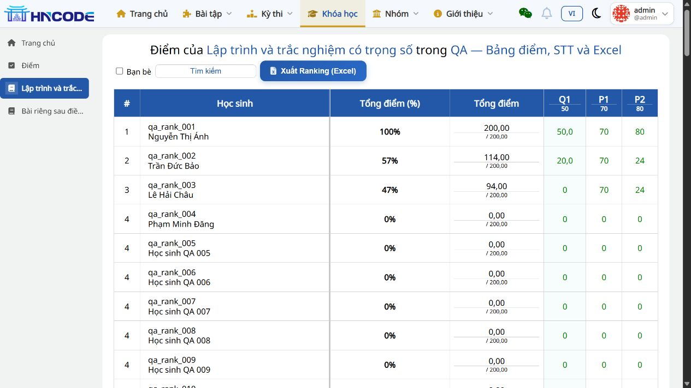
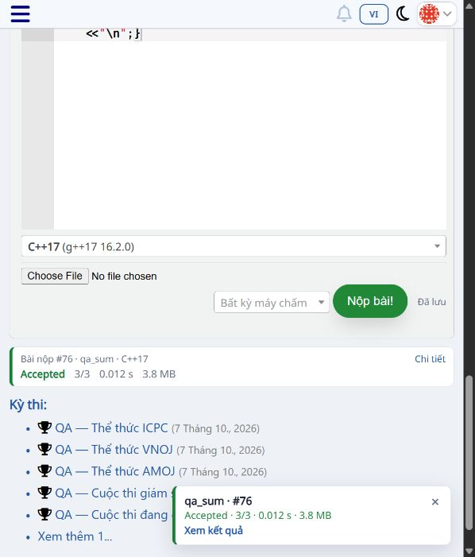
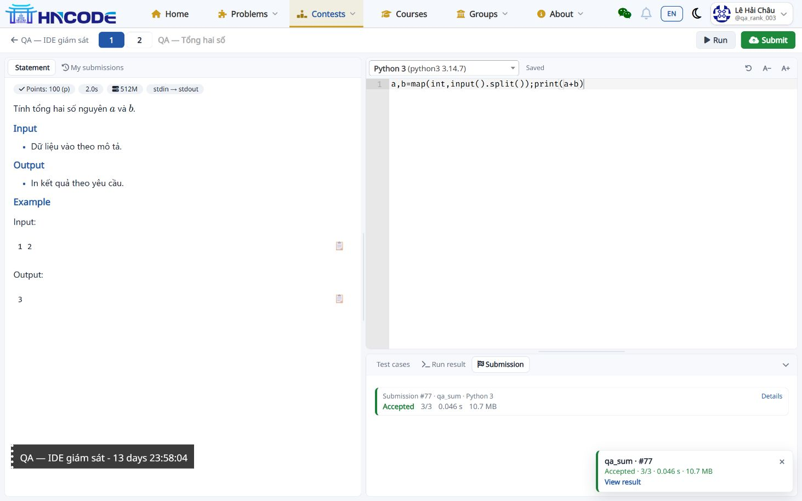
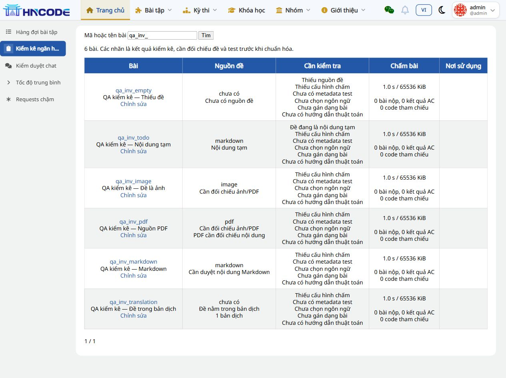

# Evidence QA local — 14/11/2026

Các file trong thư mục được chọn từ lượt kiểm tra local. Chúng phục vụ đối chiếu, team ghi bổ sung SHA và kết quả của môi trường mình vào biên bản nghiệm thu. Dataset và tài khoản có tiền tố qa là dữ liệu tổng hợp.

[SHA256SUMS.txt](SHA256SUMS.txt) chứa checksum của các file PNG/XLSX. File văn bản có thể được Git đổi xuống dòng theo hệ điều hành, nên không nằm trong danh sách checksum này.

| File | Mục đích / giới hạn |
|---|---|
| [full-suite-final.log](full-suite-final.log) | 1.349 test toàn hệ thống PASS, 110,523 giây |
| [api-verdict-matrix.log](api-verdict-matrix.log) | 9 test API PASS được chạy sau lượt tổng |
| [final-features-tests.log](final-features-tests.log) | 108 test nhóm chức năng PASS |
| [checks.json](checks.json) | Máy chấm, điểm, 103 dòng, lọc, quyền, STT; phép đo 15 query thuộc helper tính tiến độ |
| [cay-cot-qa-results.json](cay-cot-qa-results.json) | Response và phân trang cho user được scope, loại submission ngoài phạm vi |
| [inventory-qa-results.json](inventory-qa-results.json) | Sáu kiểu nguồn đề; URL ảnh/PDF là fixture, chưa có file thật để duyệt |
| [ai-missing-key.json](ai-missing-key.json) | Luồng thiếu key; chưa gọi provider thật |
| [ranking-course-103.xlsx](ranking-course-103.xlsx), [ranking-lesson-103.xlsx](ranking-lesson-103.xlsx) | File tải từ local, đủ 103 học sinh; **còn lỗi scale/format phần trăm** cần sửa và tạo lại |

Các giá trị PASS trong checks.json phản ánh các kiểm tra được script thực hiện tại thời điểm đó. Riêng tỷ lệ/number format Excel được phát hiện thiếu sau lượt xuất, nên checklist bàn giao ghi E04 FAIL và là kết luận áp dụng khi nghiệm thu #140.

## Ảnh đối chiếu

### Bảng điểm, phân trang 103 học sinh

### Nộp bài sau điều hướng AJAX

### Strict IDE, kết quả AC

### Khung kiểm kê quản trị

Ảnh chứng minh giao diện tại thời điểm chụp. Checklist thủ công về Reset, thiết bị mobile, tải toàn trang, client API và dữ liệu bài thật vẫn cần nghiệm thu theo tài liệu chính.
